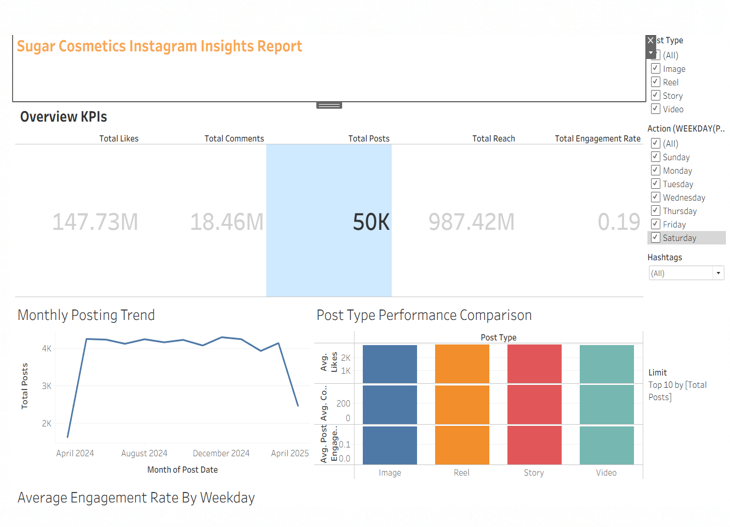

# Sugar Cosmetics Instagram Performance Analysis

An end-to-end Tableau analysis of Sugar Cosmetics' Instagram performance
(April 2024 to April 2025), with an interactive dashboard, a strategy
recommendation and a presentation.

## Objective
Understand how the account performs, which content works, and what the
marketing team should do next.

## Dataset
50,000 posts with fields including Post Type, Post Date, Hashtags, Likes,
Comments, Shares, Saves, Reach, Impressions, Campaign Type and Audience Emotion.

## What's in the dashboard (10 sheets)
1. Overview KPIs
2. Monthly posting trend
3. Top 10 posts by likes
4. Top 10 posts by engagement rate
5. Post type performance
6. Day-of-week analysis
7. Engagement funnel
8. Hashtag analysis
9. Interactive dashboard (filters by post type, month, hashtag)
10. Strategic recommendations

## Key findings
- 50K posts, 987M reach, 147.7M likes, 18.55% engagement rate
- Posting is steady at about 4,100 posts per month
- Post types, weekdays and hashtags perform within about 1% of each other
- Top 10 posts reach about 34% engagement, nearly double the average
- Comments, shares and saves are each under 2% of reach

## Recommendations
Keep the posting pace, create save-worthy and shareable content,
replicate the traits of top-engagement posts, and test timing as a
hypothesis rather than a rule.

## Method note
Engagement rate = (likes + comments + shares + saves) / reach.
No rows were removed. April 2024 and April 2025 are partial months.

## Links
- Live dashboard: [Tableau Public link]
- Video walkthrough: [link]
- Presentation: /presentation

## Tools
Tableau, Excel, Canva, Zoom

## Screenshots

!]